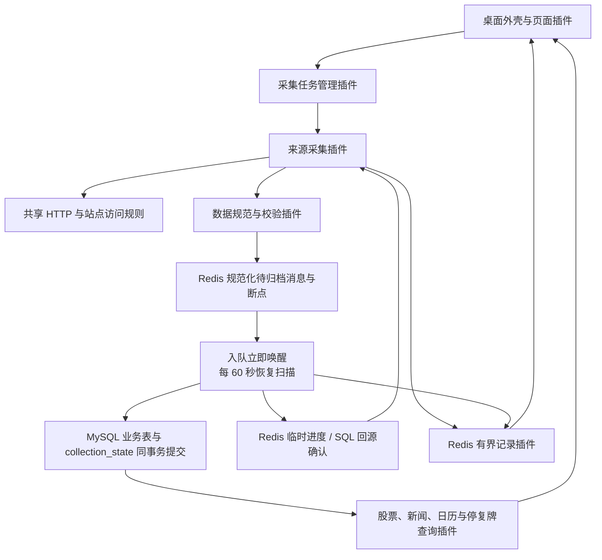

# Empire 架构设计

同花顺上市与发行详情由独立采集、数据查询及按需UI插件提供，登记 `listing.detail → stock_listing`；每证券类型化记录，复用共享请求、代理、入队、摘要及归档路径。逐证券补缺与七天全池回查见[生命周期及存储设计](ths-listings.md)，范围不包含从未采集的退市证券。

数据准备优先读取按用途、证券、日期及业务检查契约、相关查询可用性和数据库范围区分的 Redis 检查结果，完成后保存 7 天，读取不续期；手动重新检查绕过缓存并原子替换结果及有效期。未命中时只展示未核验元数据，用户手动检查后通过页面拥有的请求核验，服务锁保证不重叠；进度快照只保存有界项目证据，先呈现完整清单，再替换各项目结果。UI独立读取同范围快照，不重复SQL、不缓存完整业务正文。切页取消仍由QueryScope管理，未完成检查不写缓存；SQL线程由SQLLane保有关闭所有权，停用数据准备等待所属核验结束。Redis 故障保留检查结果并提示缓存失败，不改变业务采集、入队或归档。正式缓存契约见[数据准备](data-preparation.md)。

数据浏览目录为每个数据项目显示“数据库表”，由页面插件的 `database_tables` 声明实际浏览查询的业务表；多个表以逗号分隔，支持按表名搜索。当前股票、新闻、日历、停复牌、分红、增发、配股分别对应 `stock`、`finance_news`、`trade_calendar`、`suspension_event`、`dividend_plan`、`additional_issue`、`rights_issue`。

本文描述当前实现和已确认的存储简化方案。当前股票目录默认使用同花顺完整单页，原新浪任务可归档还原；两来源共用stock当前目录与stocks/current摘要，旧响应不能跨来源覆盖较新版本。新闻、日历及其他来源能力沿专项契约。见[当前股票目录](stock-directory.md)。

## 1. 需求基线与设计假设

| 项目 | 约束 |
| --- | --- |
| 使用方式 | 个人使用，本地 Windows，Python / PySide6 桌面 |
| 研究范围 | A 股投资研究与决策辅助；暂不接入券商和实盘自动下单 |
| 插件 | 全部业务能力由内部插件提供，运行时可启停，不开放第三方加载 |
| 发布方式 | 整个应用统一发布；代码更新后重启，运行时启停不等于代码热更新 |
| 数据服务 | 直接连接本机或已有 Redis / MySQL，不使用 Docker Desktop 或 WSL2 |
| 数据库变更 | 应用升级不自动迁移、重建或搬运数据；按实际需求显式执行针对性 SQL并记录变更 |
| 业务数据路径 | 来源响应经过校验和规范化后先入 Redis，立即唤醒归档器并每 60 秒恢复扫描；MySQL 提交后删除对应队列消息 |
| 数据保留 | MySQL 按业务粒度保存正式表及每项目一条 collection_state；完整表集合以 sql/schema.sql 和数据库参考为准，不另维护手写总数；不保留成功请求原文及历史完整股票快照 |
| 故障记录 | 采集记录每项目 100 条、归档记录每项目 100 条、错误记录每项目 300 条，都只留 Redis，不归档 |
| 频率管理 | 执行计划与 HTTP 请求间隔分开；同域名组共享间隔、并发及服务器冷却 |

应用关闭后停止采集。Windows 当前用户只允许一个 Empire 实例，不因使用不同配置文件绕开单实例保护。按用户最新要求，Redis 关闭 AOF 和自动快照，断点与运行状态只留内存，任务及网站频控配置保存于 MySQL app_setting；Redis 服务或电脑重启会丢失未归档数据及控制状态。只重启应用可续跑。服务全局配置只在明确维护时修改，应用启动不修改。

## 2. 总体结构

采用单体桌面应用、插件内核和持久化数据管道，不引入微服务、插件沙箱或外部调度平台。

界面只通过能力接口查询和操作后台，SQL、网络和 Redis 操作不在 Qt 主线程执行。异步后台负责采集、计划和归档；MySQL 按浏览与持久化职责隔离执行器及连接池。

业务浏览和采集完成确认是两个正式能力。`stocks.query`、`news.query`、`calendar.query`、`suspensions.query` 只依赖 MySQL，所以 Redis 不可用时仍可读取已归档数据；`archive.confirmation` 依赖 Redis 和 MySQL，由采集器等待队列提交时使用。Redis 故障会阻塞确认、采集、归档及临时核验，但不会把 MySQL 中已经提交的数据隐藏，也不会用 SQL publication 冒充 Redis 的“最近成功核验”。恢复 Redis 后只需恢复依赖链，无需重启四个查询插件。

### 数据库执行资源隔离

股票、新闻、日历和停复牌只读查询使用 `mysql.read` 与 `read_engine`：2 个工作线程、2 个连接，最多另排队 16 项。归档事务、配置读写、采集进度回源及补齐计划使用 `mysql.control` 与 `engine`：1 个工作线程、1 个独立连接，最多另排队 32 项。`archive` 通过 control 执行完整事务；不在页面通道执行写入，也不把浏览查询放回持久化通道。显式维护入口不变。

准入在向线程池提交之前限制；满队明确返回“尚未执行”，归档消息继续保留，配置不报保存成功。排队阶段取消则不执行；开始执行后，包括重复取消在内，都等待线程真实完成后释放额度，再向调用方传播取消，不把取消当作回滚证明。应用正常退出拒绝新请求，等待已接收操作结束再关闭连接池和线程；启动验证失败也回收资源。运行状态页展示两通道执行、等待、容量和满队拒绝次数。

这隔离的是应用排队和连接资源，不隔离同一 MySQL 服务的 CPU、磁盘或行锁；长事务仍可能延迟同通道的配置保存。新闻列表另使用已有 `(source, published_at, news_id)` 索引做稳定游标翻页，后页不使用 OFFSET 或重复 COUNT；增加线程不替代索引与查询设计。

## 3. 插件内核与能力边界

业务按 `features/<业务>` 收拢；新闻是首个样板，入口见 [新闻包](../src/empire/features/news/README.md)。`contracts/task.py` 拥有任务与默认策略类型，`contracts/bundle.py` 拥有纯贡献结构和顺序声明。`features/builtin.py` 明确列出包工厂，`bootstrap.py` 只合并公共服务与包声明、校验归属及现有插件依赖；构造声明不启动服务、不创建页面、不读取外部配置。

股东复杂样板集中在 [features/holders](../src/empire/features/holders/README.md)：`contract.py` 是纯业务契约，`query.py`/`audit.py` 是正式查询与证明核查入口，`ui.py` 贡献三个独立页面，`source.py`/`collector.py`/`dataset.py` 分别拥有来源语义、采集生命周期和统一归档映射。一个包仍可贡献多个独立插件；中央白名单只收集包声明，不把它合并为一个运行时开关。持有人插件与资本运作的原交错顺序按稳定槽保留。

共享 HTML 节点树位于 `sources/html.py`，由股东和资本运作来源解析器共同使用；它只处理节点/文本及标签、嵌套表格边界，不拥有业务字段、请求或生命周期。纯函数不注册插件，共享辅助变更须覆盖两侧消费者。目录迁移保持单任务、一次必要HTML三栏、三查询/页面、消息schema5、SQL证明contract4及数据归属；不触发DDL、清队、摘要重建或用户配置迁移。

同一包可贡献分别启停的采集、查询和 UI 插件，插件/任务/数据集按各自稳定顺序槽合并，不能依赖白名单排列隐式改变启动顺序。任务 provider、项目/job、数据贡献和 preparation 逐项核对归属；无定时任务的北交所维护发布者通过唯一脚本精确声明，源码门禁核查其真实路径。尚未迁移业务仅在 `features/remaining.py` 维护一次声明，后续批次逐步退役它，不新增第二份业务注册表。

内核只处理插件清单、依赖顺序、能力注册、状态和任务资源回收，不解释股票字段或网站规则。插件声明 `requires` / `provides`，由内部白名单注册；不存在动态扫描第三方目录。

模块依赖通过 `scripts/architecture_contract.py check` 按职责和业务归属检查，已有债务逐条登记且只允许减少。`scripts/assembly_contract.py check` 对照冻结声明快照核对插件、任务、数据集、页面及 preparation 语义；实现位置改变须给出精确映射，不能用总数相同代替身份一致。业务包迁移和退出条件见 [模块化实施方案](architecture-evolution-plan.md)。

| 插件能力 | 职责 |
| --- | --- |
| `redis.store` / `mysql.store` | 连接、能力检查与受控存储操作 |
| `http.fetch` | 统一流式读取、响应字节/文件配额、重试、重定向、域名组许可及冷却 |
| `ingest.publish` | 规范化消息与游标的原子入队、容量背压 |
| `archive.worker` | 恢复队列，验证完整批次，提交 MySQL 后确认和删除 |
| `archive.confirmation` | 供采集器读取临时归档进度；缓存缺失或不可信时回源 SQL |
| 数据规范插件 | 规范字段、身份校验与业务持久化映射 |
| 来源采集插件 | 解析来源、分页、边界校验、断点恢复；不直接写 MySQL |
| `collection.control` | 任务计划、参数、执行互斥、暂停和采集记录 |
| `collection.records` | 独立归档记录与错误样本，按项目限量保存及精确删除 |
| `stocks.query` / `news.query` / `calendar.query` / `suspensions.query` | 仅从 MySQL 读取已归档业务数据；不依赖 Redis |
| `ui.pages.<domain>` | 按统一契约贡献页面和导航分组 |

插件启动只提供能力；任务执行由统一管理器决定。停止有依赖的插件时显式处理依赖关系，并等待其拥有的协程和连接退出。UI 插件通过 `PageContribution` 声明页面，不把导航或业务按钮写死在内核。

内置数据类型通过白名单式 `DatasetContribution` 注册数据集、摘要命名空间、版本契约、聚合/增量模式、项目身份、完成判定和聚合运行标记；统一归档器只按贡献声明调度，不维护 job→project 或数据集分发表。内置任务通过 `TaskContribution` 注册展示和采集能力。控制器不再静态依赖全部采集器：停用一个采集器只令对应任务显示不可用，其他任务、设置和运行记录仍可使用；重新启用后恢复该任务。这里没有包扫描或第三方代码自动加载。

来源采集器不继承共享业务基类。`contracts.collector` 只声明入队、归档确认、错误记录、checkpoint 及运行结果的 Protocol/TypedDict；`collectors.support` 只组合可恢复容量等待、单一发布重试、归档 complete/invalid 等待和诊断写入失败保护。股票整批完整性、新闻 ID 覆盖和日历月份计划仍由各自插件拥有。公共契约与辅助模块进入严格 mypy 检查；新增采集器可按同一协议组合，不复制生命周期模板，也不能通过拼错关键字建立隐式新路径。

`PluginContext.spawn(..., critical=True)` 声明关键常驻循环，当前用于归档、调度、代理发现和 Redis 健康监测。正常停用先标记停止意图再回收任务；运行中意外完成、取消或异常退出将所属插件置为 FAILED，保留资源所有权直到显式正常停用。内核不自动重启或重放写入。普通一次性任务完成不改变服务健康；服务自报异常、健康查询异常与依赖异常投影为 DEGRADED，恢复后重新计算。后台错误摘要每插件最多 100 条、每条 2048 UTF-8 字节，存入和日志输出前通过统一脱敏，不保存原始异常到错误集合。

## 4. 股票数据与存储

股票业务表 `stock` 主键为 `(unified_code)`，只存股票属性。统一 `collection_state` 主键为 `(namespace, project_id)`，保存项目最近 SQL 确认进度；股票 publication 记录最后实际变化批次，日历 observed 记录每月 SQL 确认观测上界。业务修改和状态写入同事务完成。Redis 可信摘要命中时整个 SQL 阶段均跳过。

日历准备验收通过共享 FingerprintCache.peek 只读原子获取当前维护月份的摘要及版本（Redis TIME 校验到期索引，不清理或续期）；与一次 SQL 快照中的规范月份内容比较后补充观测上界。Redis 仅为查询插件的可选运行时证据，不增加启动硬依赖；不可用时保留 SQL 检查。该验收不改变归档免 SQL 路径，也不持久化额外状态。

股票批次身份仅位于统一状态 payload，不再重复放在股票行中。六位代码按字符串保存；统一代码如 `000001.SZ`、`600519.SH`、`920000.BJ`，市场由来源标识确定。

新批次的开始、规范化股票分页和完成证据暂留 Redis 同一入队 Stream，不另建重复暂存表。归档器取得完整证据后，在一个 MySQL 事务内替换对应来源和节点的当前列表。事务失败或批次不完整时旧列表继续可见。成功请求的完整 HTTP 原文只用于当前解析，不进入 Redis 业务队列或 MySQL。

股票列表是当前基础数据，不是历史任意时点股票池。未来历史行情等数据集应单独确定保留规则，不能直接套用当前列表的覆盖规则。

## 5. 三类记录与错误处理

| 数据 | 所在位置 | 上限与规则 |
| --- | --- | --- |
| 采集记录 | Redis 控制数据 | 每个项目最近 100 条，记录执行状态、时间与结果摘要 |
| 归档记录 | Redis 独立 LIST | 每个项目最近 100 条，记录批次归档结果 |
| 错误记录 | Redis 独立 LIST | 每个项目最近 300 条；错误原文样本每条最多 64 KiB |

三类记录都不进入业务归档队列，不写入 MySQL。错误记录包括发生时间、阶段、原因、请求地址、状态码、元数据及最多 64 KiB 脱敏样本。完整读取的原文保留完整长度和摘要；下载提前终止则 `body_complete=false`，`original_bytes` / `original_sha256` 未知，只记录 `observed_bytes` 和脱敏样本 `sample_sha256`，不冒充完整证据。公共脱敏器统一处理 URL、文本与结构化值；快照先脱敏再序列化，不对完整 JSON 替换密码而破坏其结构。

错误页通过同一记录服务分页读取摘要，每页 50 条；Redis Lua 在服务端从唯一记录 LIST 提取 `id/project/time/stage/error/status`，不把正文、URL 和元数据随列表返回。只有选中一条时才按项目与 ID 读取完整详情。每次新增、同 ID 替换或实际清理同步推进轻量修订号，静止轮询命中相同修订时不返回列表；修订号只是查询缓存失效信号，不是另一份错误记录或持久审计数据。

错误不会因为打开页面或后续采集成功而自动清除。先修复并验证问题，再在运行记录的错误页选择具体记录、确认已完成修复验证，调用 `clear_errors(project_id, record_ids)`。删除范围为确定的项目和记录 ID，期间产生的新错误继续保留；禁止按整个项目清空代替精确清除。容量超过 300 条时按有界保留规则淘汰最旧项。

独立 CLI `doctor --project` 复用声明和正式查询提供有界只读报告，使用专属 SQL 连接及查询次数/时间预算，不启动 Runtime 或后台插件。各项读取时间分别记录；SQL、Redis 或某项限额失败仍保留其他证据。运行中隔离只存在于归档器内存，CLI 无跨进程快照时明确未知，不建立新的 Redis 状态键。

## 6. 数据管道归档与断点恢复

归档统一采用业务内容摘要缓存。可信命中完全免 MySQL 访问；缺失、不一致或损坏回 SQL。数据插件声明版本维数、日期格式、时区与股票批次格式，统一层解析后比较，并核实有效期索引。观测超前本机 5 分钟、新闻修订超前观测 5 分钟只使该证明不能走缓存快径，业务仍可回 SQL 确认。SQL 成功但版本不可缓存时精确失效该键旧证明，不阻塞成功清队。股票 committed 是进度显示，不是归档清队权威；旧批次以可信摘要或 SQL 核对。插入/更新提交、确认相同或确认过时均删除对应消息；SQL 失败保留。摘要默认每数据集/来源 10000 条、7 天有效期。完整规则见 [统一归档去重](archive-deduplication.md)。

1. 来源插件取得响应并完成字段、顺序和页边界校验，生成规范化消息。
2. Redis Lua 以游标版本 CAS 校验并一次提交整页消息与下一页游标，先入队后推进断点，不产生漏页窗口。
3. 入队立即唤醒归档器检查待处理数据；每 60 秒恢复扫描，启动时先恢复遗留工作。未取得完成证据的整批数据仍留 Redis，不发布不完整列表。

   归档使用有界 Stream-ID 索引、可续进扫描游标及项目轮转。每轮默认扫描最多 500 条 / 8 MiB，扫描窗口间检查 50 毫秒预算；随后最多处理 32 个业务单元，并在单元间检查 50 毫秒预算。新闻一页、日历一月、停复牌一月、股票完整列表各为一个业务单元，股票事务不拆分。尚有工作立即继续下一轮，60 秒只用于恢复检查；未完成股票不反复读取正文。索引默认最多 100000 个消息 ID，只是可丢弃的调度状态，重启由原 Stream 重建，不增加业务表、Redis 第二份业务队列或兼容消费路径。

   股票只在扫描完成固定上界后组装，跨窗口的页不误判为缺失；判断旧未完成批次被新断点替代时，还须通过断点之后捕获的 Stream 上界，防止删除刚刚收齐的旧批次。上界取 `XINFO STREAM` 的 `last-generated-id`，不以队尾存活消息下降误判队列重建。单项目失败留队并延后重试，不占住其他已发现项目；未知 schema 按明确登记归属隔离项目，归属不明仍全局暂停。预算是协作让出边界，不强制取消正在执行的 Redis I/O 或 SQL 事务；数据库慢读/写入隔离仍是后续独立优化。
4. 完整证据验证数量、页连续性、唯一身份及首尾一致性，在一个 MySQL 事务中发布当前股票列表。
5. MySQL 成功提交、确认已有相同内容（含可信摘要命中）或确认消息过时后，执行对应 Redis 消息的 `XDEL`。如果进程在提交与确认间退出，重复投递通过摘要或 SQL 核对处理，不重复累积业务数据。
6. 必要断点、当前发布结果和有界记录留在 Redis，支持重启继续。进程退出不能清空未归档队列。

MySQL 写入失败时保留规范化待归档消息，并在 Redis 留下归档失败记录；不会把有效业务数据复制成错误原文样本。错误样本针对 HTTP、解析、来源校验或结构不兼容等问题，不能把错误原文或失败消息写进 SQL 隔离表。无效消息不得成为当前业务数据，其诊断样本也只留 Redis。当前没有 MySQL 原始事件表、分页证据表或隔离表。

背压检查本应用队列条数、单页字节和共享 Redis 内存水位。达到上限时暂停采集而非裁剪未归档业务消息。股票在取得总数后、发布 `start` 前，一次预留 `start + 剩余分页 + complete` 的消息槽和最坏正文预算；断点恢复只预留尚未发布的分页及 `complete`。其他普通入队和其他整批任务都必须避开这些预留，成功写入 Stream 后才逐条消耗，失败、取消或提前结束释放未使用部分。同一任务不能同时持有两份预留。

预留只存在于当前 Empire 进程，不增加 Redis 键或第二套断点：进程异常退出后预留自然消失，已经成功发布的 Stream 消息及断点仍按正式路径恢复，重启后根据断点重新计算剩余量。它防止 Empire 自身任务互相挤占完成槽，不承诺锁定共享 Redis 的物理内存；外部进程继续写入或 Redis 实际开销超过正文估算时，仍由 `maxmemory/noeviction`、水位和 Stream 原子容量检查拒绝。无法容纳的批次在首条业务消息入队前明确暂停，不能靠丢消息解除阻塞。

## 7. 跨插件共享采集频控

动态代理池作为独立基础设施插件接入。任务只选择本机直连、代理优先或仅代理；HTTP 层统一管理网站整体间隔、总并发和单个出口间隔，429 冷却所有出口。目录支持声明 HTTP、HTTPS、SOCKS5 和 SOCKS5H 入口，并同时核实 Hash 映射与 ZSET 有效期，详见 [采集出口与动态代理](proxy-collection.md)。

`sina.com.cn` 与其所有子域名属于同一 `sina` 组，股票和新浪新闻共用许可。每个请求，包括本机直连、代理、代理回退、重试和重定向，都先通过同一个 routing 入口取得许可；不存在无代理池时切换到旧限流算法的运行时分支。Redis 保存组下一次许可时间与 429 冷却截止时间，使用 Redis 时间避免本机时钟漂移；并发槽在当前单实例进程内管理。

响应元数据通过统一 HTTP 安全模块处理。`Retry-After` 接受非负 ASCII 整数秒或 HTTP 日期；非法值回退 30 秒，合法长冷却保留完整截止时间。超出 Redis 精确毫秒表示范围的整数保守饱和到安全截止时间并显示诊断；许可只分段返回最多 60 秒的等待量，不缩短截止时间。重定向按协议、主机及有效端口判定 origin；跨 origin 后清除认证参数、Cookie 参数及最终请求中的认证/Cookie（含客户端默认值和 Cookie jar），之后不会在跳回原站时恢复凭据。禁止 HTTPS → HTTP 降级，目标仍须通过采集器域名声明及目标组频控。正文与文件下载共用此边界。

任务计划决定何时启动采集。站点自动模式按健康独立 `exit_ip` 数扩展，以“站点组 + 出口 IP”维护独立间隔；同一公网出口下的多个设备共享许可。全局下载窗口作为共享安全阀；站点 `max_concurrency=0` 跟随全局，正数是更严格的站点上限。全站每秒保护默认关闭并可在高级设置启用。网站规则保存后作用于后续许可申请，既有冷却不因改设置被清除；全局下载资源保存后正常重启生效，避免运行时双份额度。

支持独立分页的采集器通过公共 `ordered_prefetch` 使用有界并行下载窗口，全局默认 128、最多 1024，实际同时受健康出口、站点保护、字节预算及页数限制，不按规划设备数固定发请求。新浪股票首先获取总数，预取后由单一消费者按页顺序校验和原子提交断点，最后执行尾页与总数验证。后页不能越过失败页推进断点；所有预取请求在结束、失败和取消时回收。所有正式采集任务沿用共享有界预取：财报、上市资料按证券，分红按报告期（未证实证券先做历史日期发现），行业按目录中的成员响应，日历按月份，停复牌与上市状态按日期，增发详情按唯一方案 ID；来源校验和发布仍按业务顺序。新闻依赖前页 ID，配股和更名只有必要完整响应，窗口不人为扩展。完整任务边界见 [共享预取](all-collector-prefetch.md)。每页诊断使用独立运行上下文。采集控制器声明任务并行能力，UI 只显示能力、当前容量及限制原因，不实现调度逻辑。

页数窗口之外，所有来源和出口共享 512 MiB 默认缓冲预留预算。股票、新闻、日历使用各自响应分类，默认传输/解压正文上限为 1 MiB、4 MiB、512 KiB；预留考虑组装副本，直到按序处理完释放。大文件走相同 HTTP 入口的文件契约，流式写盘，独立限制文件大小、磁盘配额、余量和并发，校验后发布且不覆盖已有文件。资源数值由独立下载资源页面保存到 MySQL，进程启动一次性载入，保存后下次正常启动生效；下载目录作为机器路径仍保存在 TOML。规划设备 100～1000 十档推荐由公共纯契约计算，UI 与维护入口共用，不另建推荐服务或运行时配置源。它不是第二套 HTTP 实现，也没有新增公告/PDF 解析业务。参数、生命周期和诊断语义见 [下载资源边界](download-resources.md)。

## 8. 桌面与统一管理

管理界面也按业务划分独立 UI 插件，运行时只聚合 `ui.pages.*` 页面贡献。公共控件不反向依赖业务页；采集任务、网站频控、运行历史分别拥有控件与草稿，复杂任务页再拆布局和交互。组织方式及文件规模约束见 [管理界面插件](ui-plugins.md)。

页面按工作台、数据准备、数据浏览、采集管理、系统设置和说明文档组织，实际页面集合来自 PageContribution，并由文档覆盖登记核对。运行记录页使用采集、归档、错误三个标签，不为记录类型增加新的侧栏入口；采集管理另有独立采集出口页。软件内“说明文档 → 技术参考 → 系统架构”提供面向日常维护的离线架构概览。

执行计划支持手动、固定间隔和北京时间每日定时；同一任务不重叠。正常暂停同时禁用后续计划并保留断点；恢复前启用并保存。错过的计划只补执行一次，不堆积历史周期。计划草稿与已保存配置分开，刷新不覆盖输入。

股票表格按 `(unified_code)` 维护选中身份，不依赖行号；刷新、名称变化或排序变化后仅恢复仍在当前结果中的对象，已消失对象清除选择。公共控件负责一致行为，页面不复制一套选择恢复逻辑。

全部后台只读 `invoke` 通过公共 `QueryScope` 按页面和请求键管理。同步提交失败与 Future 异步失败进入同一结果路径；切换筛选、月份、项目或分页时先取消旧读，已经开始且无法取消的结果即使稍后返回也按请求身份丢弃。成功读取时间与当前失败分开记录：刷新失败时保留已有数据并明确标为旧数据，不把旧表格伪装成此次刷新成功。页面销毁会取消其只读请求；保存配置、执行任务和精确清除错误等写命令不归 `QueryScope` 所有，不因切页销毁而取消。

页面贡献工厂有外壳级局部异常边界。单个页面构造失败时只在该页面显示脱敏错误与重试入口，导航、其他页面和桌面刷新循环继续运行；重试重新调用唯一页面工厂，不建立备用页面实现。

页面生命周期同样由外壳统一管理：隐藏时停止页面树中的周期定时器并取消 QueryScope 只读请求，重新激活后恢复；写命令不属于 QueryScope。只读页使用最多 8 个实例的 LRU，淘汰时只保存筛选、稳定身份选择和滚动等小型交互状态，不保存业务结果。编辑和精确清理页面默认常驻，不能为了回收丢失草稿或写入回执。详见 [页面生命周期与有界缓存验收](page-lifecycle-review.md)。

详见 [桌面使用说明](desktop-guide.md) 和 [统一采集管理](collection-management.md)。

## 9. 数据库变更和发布

应用正常启动不自动 DDL。MySQL 基础插件只验证 `app_setting` 和 `collection_state`；股票、新闻、日历数据插件分别验证自己的业务表并提供对应 schema 能力，采集器只依赖自身 schema。某张无关业务表异常不会阻断其他已归档数据浏览。`init-db` 是显式创建缺失业务表的命令；不是应用升级步骤，不执行旧表清理或数据搬运。

从旧结构改为单表时，先核验并保留当前完整股票数据，再执行本次已确认的针对性 SQL，最后核验数量与关键字段。相关 SQL 与实际执行记录由 `sql/changes` 管理，不由启动过程自动重放。共享 Redis 的其他项目、数据库服务和持久化目录不在清理范围。

MySQL 是业务数据与正式设置的唯一持久恢复源；Redis 纯内存状态不纳入恢复承诺。逻辑备份必须在不同且以 `_restore_drill` 结尾的隔离库恢复，并按九张正式表的结构、行数和内容摘要核对后才能标记为已验证。清单工具只读且不建库、删库或替换生产；生产恢复必须另行确认。当前未登记已验证备份，因此不宣称磁盘故障后的固定 RPO/RTO，完整流程见 [故障恢复与隔离演练手册](recovery-runbook.md)。

## 10. 后续范围与验证

下一数据渠道通过来源插件、规范映射和统一管理任务定义接入；新闻不等于上市公司公告，巨潮交易提示也不能直接代表完整历史交易日历。选股与回测前还需行情、复权因子和历史上市状态等可靠输入。

所有数据插件必须按业务唯一键比较规范化内容及来源版本，完全相同则跳过业务 DML，不仅为了刷新观测时间执行写库。新闻每页批量读取比较后，仅提交新增或有效变更；股票完整列表相同则不替换，最新核验批次用 Redis stocks:committed 保存。来源版本变更即使正文相同也需要保留，以阻止旧版覆盖。测试必须验证重复采集无业务写入、修订、旧响应和重放。

关键验证包括：分页中断续采；不完整批次不覆盖当前表；提交后确认前故障恢复；旧消息重放；保存失败回滚；跨插件频控；三类记录按项目独立限量；错误样本脱敏和截断；精确清除时保留新到错误；桌面异步查询与草稿保护。测试使用专属命名空间和来源，只清理测试拥有的数据。

## 新浪财经新闻扩展

新闻页通过 news.query 能力读取 finance_news 表。列表以首屏记录固定查询上界，下一页携带最后一条 `(published_at, news_id)` 游标；新入库新闻不改变当前翻页快照，首页定时刷新开始新快照。空搜索不生成 LIKE，精确总数只在首屏读取。标题/正文搜索保留包含语义，当前数据和百万行临时压测不足以证明应改变为中文分词语义，因此未增加全文索引或第二搜索路径。

news.flash.page 是独立可归档页面，archive.worker 通过数据契约映射执行追加/修订写入；不依赖股票完整批次，也不会清理历史新闻。按来源 ID 的采集分页与增量断点实现见 [新浪新闻](sina-news.md)。SQL 提交后更新 Redis archive:progress:<job_key> 并删除消息；旧重放不会倒退最新归档进度。

## 巨潮交易日历扩展

calendar.query 按 SQL 日期完整性生成历史补采计划；collector.cninfo_calendar 请求历史缺月及本月至下一年 12 月。整月校验后独立归档，不变日期无业务 DML。统一状态的 observed 保存各月 SQL 确认观测上界，Redis 摘要保存缓存确认版本，阻止旧响应倒退。来源请求共享 cninfo.com.cn 频控。详见 [巨潮日历](cninfo-calendar.md)。

## 通达信历史停复牌扩展

来源日历日期单独保存为`suspension_source_date` 关联表，事件以 `source_dates_known` 表达已知性；消息仍携带 `source_dates` 集合。采集月聚合保留每个已核实查询日，归档按并集合并并保持内容旧版防覆盖；可信摘要身份包括该日期集合，防止不同日期的迟到响应被旧版缓存短路。浏览日历以真实来源日期过滤，与停复牌生效时间分别展示；SQL 连续覆盖重建后才用作日期完整性证据。现行入队契约 `suspensions.period@3` 使用完整日集合及唯一业务键核验，避免同证券跨偏移页重排。各数据贡献声明现行 schema_version，统一目录不保留旧版本运行时兼容路径。显式迁移保留旧业务记录并重建完整性版本与覆盖，详见 [完整性修复](tdx-completeness-fix-2026-09-29.md)。

停复牌断点仅保存起止日期、月份索引和下一未发布日期，完整月份计划在内存重建。月份超过公共单次入队字节上限时按连续日期分段，按序入队后继续采集，不逐段等待归档；Redis 存在时恢复未发布范围，Redis 丢失时从 SQL 连续覆盖上界重查。采集和归档独立运行，整轮入队后公共完成确认检查成功标记及本轮 Stream 消息已清理，不能只凭最高成功页码。

`suspensions.query` 根据 `collection_state.coverage.through` 生成连续日期计划；`collector.tdx_suspensions` 首次逐自然日核验 2004-12-27 至北京时间当天，后续从最后 SQL 确认日重查至当天。每天翻页到空页，允许分页夹带 B 股，但过滤后的沪深 A 股数量必须等于来源 A 股计数；整月全部日期通过后才发布归档消息。来源记录以 `unified_code + suspended_at + resume_key + record_key` 唯一，不同复牌时间（含未知）以及同一时间下不同来源说明/原因分别保留；完全相同内容不写 SQL，迟到的完全相同响应不覆盖，来源遗漏不触发删除。详见 [通达信停复牌](tdx-suspensions.md)。

## 配置持久化与二级导航

任务策略与网站请求间隔通过 SettingsStore 直接提交 MySQL app_setting，按 namespace/kind/setting_key 隔离；不进入业务归档队列。SQL 保存失败不修改生效值；SQL 成功但 Redis 同步失败时保留已提交配置并明确提示。启动从 SQL 恢复配置，相同策略保留 Redis next_due；Redis 丢失则重建时间，不补跑停机期间所有次数。旧配置仅通过显式维护脚本迁入，启动不执行 DDL。

下载资源同样使用 SettingsStore 的 MySQL 正式路径，记录为 `kind=download`、`setting_key=global`。界面维护编辑草稿，后端统一验证字节整数、范围、最大响应与缓冲关系及文件上限与配额关系。保存只更新持久值，不重建在用下载器、不缩减已经分配的额度；页面将当前运行值与已保存值分开显示，正常重启后才整体启用。旧 TOML 数值只由 `scripts/migrate_download_settings.py` 显式迁移，运行时拒绝旧数值字段，避免双源优先级和部分热更新。

容量升级通过 `scripts/migrate_download_capacity.py` 把旧九字段 SQL 下载配置补为完整十一字段；显式应用档位及自动站点跟随策略在同一 SQL 事务内校验提交，不做 DDL、不访问业务表或删除 Redis 数据。运行时只接受现行完整契约。代理目录用共享周期快照和逐候选原子核实分离“发现”与“实际分配”，避免每个请求全量扫描；候选映射及租约仍用 Redis TIME 核实，连接退役保持关闭所有权直至完成。

桌面一级菜单按 PageContribution.group 构建，二级菜单展示该组页面；navigate 自动切换两级并保留页面控件与草稿。

## 多项目管理与按需加载

采集控制提供 workspace 的有界任务/网站/历史视图和概览汇总；桌面不再每次读取全部任务与全部历史。任务定义声明业务分类与来源显示名，数据页面声明目录元数据，新增项目不扩展一级菜单。具体字段、分页、按需创建和当前单机执行边界见 [可扩展工作区](scalable-workspace.md)。

数据准备由独立 data.preparation / ui.preparation 插件提供一级入口，按查询插件的 PreparationContribution 汇总只读证据。业务 SQL 属于各自查询插件，外壳仅增加导航排序；停复牌业务表通过显式变更建立，启动不迁移。详见 [数据准备](data-preparation.md)。

数据准备目录按独立输出声明 kind/boundary/related/dependencies：采集单项自主完成，只有整理、计算、核对使用真正的输入依赖。相同项目不能冒领多个计划项；来源采集与派生结果共用进度展示但不混算。目录分模块组织，正式入口仍为 preparation_catalog.py，无存储结构变更。

Requirement.fields 表示本用途必需信息，optional_fields 表示缺少不阻塞的增强信息。通用范围和日期规则由 preparation_definition 声明，界面同步展示；来源检查器按单一来源的声明范围返回六项结果。任意一个来源独立通过即可完成，其他来源的失败不构成阻碍；不拼接不同来源的零散通过项，也不要求跨网站互证。股票、新闻、日历和停复牌各自使用独立业务存储及数据检查路径。

数据准备进一步校验采集能力及实际插件提供者不能对应不同采集输出；各数据独立插件、独立任务、独立验收，共享基础设施。详见数据准备全目录复核说明。

通达信增发送配新增 `dividend_plan`（分红送转）、`additional_issue`（增发）、`rights_issue`（配股）三张独立业务表，仍共用 `collection_state` 每项目一行状态。显式维护入口为 `scripts/migrate_business_schema.py`，应用启动不改表。生命周期、来源口径与操作见 [通达信增发送配](tdx-capital-actions.md)。

增发现行 additional_issues.unit@3 在同一 additional_issue.payload.detail 保存有效明细或明确暂无可用详情状态，并保留接口码和可选上次有效明细。未采、损坏和网络异常不能冒充暂无；明确空/-1005状态归档后可完成采集，明细用途仍有限制。未变内容复用统一指纹、相同内容无业务DML，归档成功清队。维护入口 scripts/migrate_issue_availability.py，无DDL或业务身份变更；保留既有业务和可验证未变摘要，重建受影响证明/断点。当前完整来源证明必须精确匹配SQL规范集合，才能将额外未知历史记录单列为范围外；否则仍失败。见[现行暂无规则](tdx-issue-availability.md)。

2026-09-30 增发送配错误分类修订：连续五个停止保护针对网络/结构异常，明确 -1005 源站记录错误不计入阈值，单证券缺口仍保留。增发同编号别名可在本轮内存共享明确失败，次轮重新请求，不写永久失败缓存；失败详情不变成空值。见[增发详情](tdx-issue-details.md)。

2026-10-01 增发送配规划调整：来源完整集合/分红股票池变化时自动建立新批次，从新范围重建证明；首个有效单元与新断点原子提交，旧消息沿用统一归档及版本保护，未变化增发详情仍复用 SQL，不新增计划或永久缓存。来源校验未通过不能自动换范围。详见[增发送配](tdx-capital-actions.md)。

增发此前的 -1005 诊断冷却已退役。新的正常轮次重新核实暂无方案，同编号本轮复用；强制未完成轮次仍可复用本轮可信指纹确认的未变状态。状态参与业务比较，不保存成功原文或另建失败缓存。历史诊断按登记的确切ID、对应状态正式归档验证后清理，不能无条件清空。

## 同花顺三大报表

利润表、资产负债表、现金流量表分别由独立任务和查询插件提供。生命周期、来源精度及验收限制见 [同花顺三大报表](ths-financial-statements.md)。历史选股所需公告日期尚未提供，不宣称信号数据准备完成。

数据准备按开发证据、来源集合完整性、来源质量和用途条件分别呈现。三表的范围请求由 preparation_scope 契约校验，数据层 financial_preparation 在一致 SQL 快照中核对完整证券摘要再检查所选报告期；UI 页面拥有用途/范围草稿，问题样例最多每检查项100条。非阻断标记只允许财务分析的时点限制，不能绕过键、覆盖、金额质量或回测可用日期。报告进度快照不启动新 SQL 扫描；手动重新检查沿同一正式报告路径运行，保持开发与实采验收分离。

停复牌日频验收由 trading_day_cutoff 只读查询正式cninfo交易日历确定最近结束日，覆盖数据集的结束界点为北京时间15:30。连续日期与来源日历保留原义；休市验收不修改采集游标、SQL覆盖、归档摘要或任务计划。日历缺失保持未知，来源范围之前的历史单列限制。

## 采集任务页面组织

采集管理内的任务页面以数据来源为一级、具体任务为二级菜单，沿用 collection.control.workspace 的25项有界分页与稳定任务ID；不是给每个采集器增加固定外壳菜单。TaskMenu拥有展开/选择状态，TaskRuntime负责只读分区，TasksPage管理查询、计划草稿及命令；UI层不添加采集规则。来源分组不执行命令，具体任务仍独立配置和运行。运行统计、归档确认及来源质量分别表达。

采集任务页面自行约束外壳的高度计算：长详情由标签内ScrollArea负责滚动，不把详情文本的首选高度递归传给整个页面。TaskRuntime按实际详情宽度重排前两个分区；任务页紧凑标题、菜单分页及空态由页面负责，外壳与其他采集管理页保持原职责。公共Pager提供可选紧凑显示，完整分页语义及无障碍名称保留。

下载拒绝错误通过DownloadReadError保留有界不完整诊断；DownloadLimitError表示不可重试的资源/格式错误，DownloadIncompleteError表示可重试的未完整传输。后者直接接入HttpService现有重试预算和总时限，不触发仅凭源站正文截断判定代理失败的隔离逻辑，也不放宽正文完整性、大小或文件发布规则。

## 同花顺当前行业

collector.ths_industries 复用共享 HTTP、代理与频控，本地固定版本校验脚本只生成请求校验值。每行业 page/1/size/1000 完整响应验证后，与完整目录一起作为一个 industry.snapshot 入队，统一归档在一个事务内维护 industry、industry_member 与每项目 collection_state。data.industries 提供 MySQL 查询和准备检查，ui.industries 按需创建目录页面。没有历史快照或另一套下载器。

行业完整性契约 2 使用 ths_industries_v2 摘要及 SQL contract_version=2，旧证明不能放行数据准备。响应仍有分页或行数达到 1000 时失败，不增加第二套分页回退路径。

## 开盘啦分时与竞价

原 collector.kaipanla_intraday 合并任务已于 2026-10-05 退役；七个 collector.kaipanla_<kind> 分别校验和原子入队本项完整证券日。上市元数据、正式日历及明确有界全天停牌只确定请求范围；源站错误不会变成空日。七个数据集 kaipanla.<kind>.day@1 以 kind/unified_code/trade_date 保存 stock_market_day，每项独立有序数组保留同分钟或同秒多点。七个 data.kaipanla_<kind> 负责本项 SQL 查询与范围验收，ui.kaipanla_<kind> 按需创建目录页面；旧 stock_intraday 仅为显式迁移来源，验证转换后删除。

独立容量实验 `scripts/measure_kaipanla_day.py` 只启动HTTP基础设施依赖和只读分时查询，通过正式代理/频控与文件契约将已核实接口内容写入专属临时目录。历史回放去除来源百分号/zlib编码后按完整数组测量，与gzip和实际文件分配空间分别报告；实验结束核实目录所有权并删除正文。它不贡献新数据集、业务表、正式入队或归档路径；范围限制及失败保留在容量报告中，未来正式接入另走插件准入。详见[容量实验](kaipanla-storage-measurement.md)。

共享下载器的 attempt_options 只允许内部调用者生成 data/headers，并明确禁用重定向；每次实际尝试在原重试预算和频控内生成匿名设备字段。七项通过 TaskContribution.default_schedule 声明每日北京时间18:00的推荐默认计划，只有没有SQL保存值时采用默认；用户可修改执行方式、时间、启停与网络，重启不覆盖已保存选择。普通采集逐证券补 SQL 缺日和新增日，每周复核最近五个已结束交易日；复核日期与成功标记使用现有有界断点，整轮归档成功才推进，Redis丢失按SQL恢复并重新复核；只有全轮入队结束才等统一归档确认。业务成功由统一归档器删除消息，不增加另一队列、摘要或归档器。详见[生命周期与维护](kaipanla-intraday.md)。

## 项目状态的局部访问

财报及分红、增发、配股数据集通过 state_unit 显式声明当前证券单元或 manifest。统一归档器仍锁定 collection_state 的项目行，但只投影 contract_version、progress、manifest 和当前 units 单元；JSON_SET 只提交变化路径，保留其他证券。全状态审计读取继续用于范围证明核验。完成等待的 SQL 回源只读取 progress，不传输整个财报状态。业务写入和局部状态更新处于原事务，缓存可信命中仍免 SQL。

## 2026-10-05 开盘啦七项拆分

分时走势与开盘竞价拆为独立项目，并新增分钟量额、分笔、分钟委托汇总、大单净额、历史盘口摘要，共七项采集/查询/UI 插件。共享 `stock_market_day` 的类型、证券、日期业务键，沿统一 Redis 入队与归档；重复内容及仅元数据时间变化不写业务表。新增任务默认停用，开发与重启不会启动全历史采集。旧合并任务由显式维护入口迁移，启动不自动转换。日常操作、生命周期和限制见 [开盘啦七项历史数据](kaipanla-intraday.md)。

## 开盘啦类型化存储与公共契约

stock_market_day是聚合业务头，七个数据集声明各自父子表集合，统一归档器在原证券日事务中完成事实差异、摘要和collection_state更新。分钟、竞价、盘口采用类型化列，分笔采用最多200点的无损压缩块；各自业务身份及来源顺序不变。覆盖只投影父头证明，详细准备仍流式核验正文；页查询有界，分笔支持绑定时段和内容版本的游标，同秒多笔跨块不丢失。sql/schema-contract.json统一登记24表的类型/空值/unsigned/主键/索引/CHECK，运行核查与公共发布门禁复用，不另建归档器或旧JSON运行分支。

## 通达信公司与股票更名（2026-10-05）

公司全称与证券简称分别接入独立采集、查询和数据浏览插件，共用有类型的security_name_change事件表。默认每天北京时间18:00各请求一次完整历史，统一入队和归档；缺名、来源重复出现次数和链断裂保留并独立验收。生命周期、字段、查询、显式建表及用途限制见[公司与股票更名](tdx-name-changes.md)。

## 更名行业字段和普通查询验收（2026-10-06）

更名接口zjhhy/tdxhy接入两类事件的有类型列及数据浏览，行业标签不冒充历史归属。普通查询保留缺名、断链及方向限制，可用性按用途核验；历史回放要求仍单列。schema2、contract2及v2摘要通过显式加列和完整重采建立新证明。见[升级设计与维护](name-change-industry-upgrade.md)，实际验收另存日期证据。

## 通达信上市状态事件

listing_status.month贡献security_listing_event结构化事件表；独立采集、查询和按需数据目录UI插件使用公共下载、代理、tdx频控、入队、统一归档与摘要。逐日验证、按月入队后继续下载，整轮等待归档；每项目一条collection_state保存月份完整集合证明。正式查询列表不投影说明，详情按身份查询，不依赖Redis。见[来源与生命周期](tdx-listing-status.md)。

## 同花顺当前指数及成分

collector.ths_indices读取zs完整目录，逐指数使用共享有界预取下载page/1/size/10000响应，按序校验并独立发布。数据集index.catalog及index.members负责stock_index和stock_index_member两张结构化表；indices.query提供主键游标分页及完整集合检查，ui.indices按需创建并登记数据目录。一个项目一条SQL状态；来源暂无保留旧成员作历史参考，成功清队仍由统一归档器执行。生命周期和字段见[指数说明](ths-indices.md)。

复权计算由data.adjustment和独立ui.adjustment插件提供，adjustment.query.calculate只读单一SQL快照，复用已归档资本事件及类型化行情；不引入因子采集、数据集归档或重复存储。数据准备以ComputationContribution登记按需处理契约和当前版本测试，不把查询计算伪装成归档任务。

北交所历史代码映射由显式导入入口使用共享下载、统一入队及归档，独立security_code_alias按两端证券身份查询；无新增后台定时任务。见[bse代码映射](bse-code-mapping.md)。

## 同花顺指数历史日行情

collector.ths_index_prices / data.index_prices / ui.index_prices独立贡献；index.price.status与index.price.year归属ths-index-prices。结构化index_daily_price事实与index_price_year年度证明同事务，collection_state仅状态及版本；复用共享下载/代理/预取与统一入队归档，不使用all.js双读。见[生命周期及存储设计](ths-index-prices.md)。

实施ST/撤销ST按两个采集、查询和UI贡献登记，复用共享单完整单元预取、原子三市场入队及统一归档。共表security_st_event，业务身份与原因结构化，参见[来源设计](tdx-st-events.md)。

## 数据预览与只读查询（2026-10-11）

数据目录保留27个独立 PageContribution，以业务用途和呈现方式导航。NavigationContext 显式校验统一证券、带来源指数、日期范围、单日及事件键；外壳管理返回历史、按需创建与LRU状态，QueryScope管理只读取消，写入不受切页取消。候选搜索包含对应已归档历史身份；开盘啦候选先有界选出证券再关联名称，避免先连接全部证券日。

公共卡片、日历、目录与时间轴组件独立；各页面声明业务字段、单位和缺值。全日图查询完整有限证券日，分笔按时间窗和原始seq查询，指数范围图上限40年/15000日，财报矩阵按选定证券完整历史；明细另行分页。图表不保存冗余业务副本，不触发采集或DDL。新增查询反例及交付边界见[实施记录](evidence/data-preview-redesign-2026-10-11.md)。

七项交易规则与税费按独立collector/data/UI贡献登记，共享RuleSources的一分钟解析缓存和typed参数/引用表；必要正文在公共预取消费期间解码，成功原文不持久化。只有已审核参数及引用集合可原子入队，未知新规则拒绝；每项独立摘要与SQL状态，见[规则设计](trading-rules.md)。

东方财富股票回购：`eastmoney-repurchases`任务与`stock_repurchase_plan`正式表，数据目录按需打开方案列表及详情；固定2000ms、每日18:00全量核验。字段、生命周期、显式建表和容量证据见[股票回购](eastmoney-repurchases.md)。回购完成不推断注销。

## 通达信财报解读五项（2026-10-12）

业绩预告、快报、披露时间、报告及股东户数分别登记独立任务、结构化表、查询和按需数据页面。每页10000已实测；四报告按季度完整响应并行预取，户数按证券历史预取，按序校验入队，整轮后等待归档。实际已归档进度与最终部署见带日期证据，不以接口支持范围冒充采完。操作、字段、恢复及限制见[通达信财报解读](tdx-performance.md)。

同花顺三项持有人（2026-10-13）：一个股东研究采集任务一次下载HTML并校验前十大股东、前十大流通股东、十大债券持有人，统一入队归档；三个数据查询/UI页面按需创建。正式存储为 `holder_report` 报告头和 `holder_member` 当前/退出名单，无业务JSON；每日18:00、代理优先，新任务初始停用。当前可见窗口、部分变动公告、债券来源序号缺口及恢复限制见[持有人说明](ths-holders.md)。实采范围与开发验收分别记录，未声明全市场已采完。

大小非解禁个股与对应股东明细通过一个通达信任务采集，列表参数10000000；列表事实与共享请求组明细分表，完整月市场统一归档。使用、生命周期、来源日期限制及验证范围见[大小非解禁]( tdx-unlocks.md)。

大小非解禁行业采用独立采集/数据集/查询/UI插件；当前目录逐月独立入队，月集合事务写restricted_share_unlock_industry，整轮归档后完成。

数据准备的来源质量限制由PreparationContribution.analysis_quality_limits显式声明，默认关闭；公共汇总器仅在分析用途接受已声明quality或temporal限制，字段、身份、覆盖及未知证据仍阻断。持有人三栏按各证券独立证明核验，来源到汇总及用途规则见[数据准备](data-preparation.md)，不在外壳加入来源特例。

## 公司资本运作响应组

ths-capital任务使用collector.ths_capital→ths.capital.security→八个类型化业务表→ths_capital.query；来源一次完整HTML，独立证券共享预取，按序原子入队后继续，整轮末归档确认。每个栏目独立数据准备，统一response_group，不用运行成功替代字段/集合审计。数据库字段见程序内数据库参考，生命周期见[公司资本运作](ths-capital.md)。

研究模板在preparation_research引用唯一目录；scope扩展study/focus/scan，分析和历史信号时点规则沿用各来源正式检查器。库存聚合在独立preparation_inventory数据模块，复用SQLLane；页面动作、范围草稿、库存展示分模块，外壳无新增业务逻辑。库存只有有界元数据和统计，不新增事实表或配置种类。
